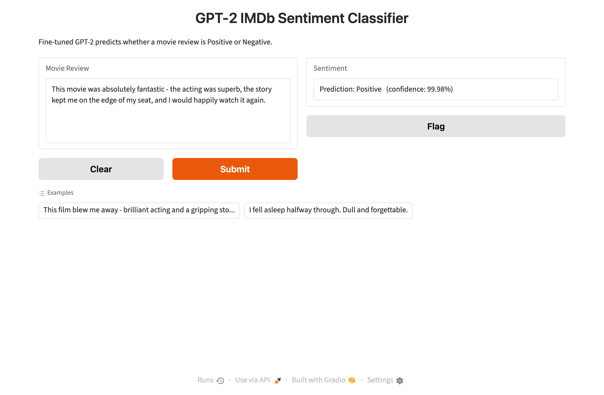

# Fine-Tuning GPT-2 for IMDb Movie Review Sentiment Classification

Fine-tune the pretrained **GPT-2 (124M)** language model with a 2-class classification
head to predict whether an IMDb movie review is **Positive** or **Negative**, then serve
the model through an interactive **Gradio** web app.

## Result

Trained locally on an Apple Silicon Mac (MPS GPU):

| Epoch | Eval loss | Eval accuracy |
|:-----:|:---------:|:-------------:|
| 1 | 0.953 | 81.2% |
| 2 | 0.481 | 86.0% |
| 3 | 0.688 | **86.8%** (best checkpoint) |

Sample predictions from the saved model:

- *"An absolute masterpiece, I loved every minute of it!"* → **Positive** (99.98%)
- *"A boring, predictable mess. Total waste of time."* → **Negative** (99.99%)



## Pipeline (14 steps)

1. Verify hardware & import libraries
2. Load the IMDb dataset (`stanfordnlp/imdb`)
3. Load the GPT-2 tokenizer (EOS used as the pad token)
4. Tokenize (padding, truncation, max length)
5. Create smaller train/test subsets
6. Initialize GPT-2 with a 2-class classification head
7. Define the accuracy metric
8. Configure fine-tuning (`TrainingArguments`)
9. Fine-tune with the Hugging Face `Trainer`
10. Evaluate the fine-tuned model
11. Save the model + tokenizer
12. Create a `sentiment-analysis` inference pipeline
13. Build a Gradio interface
14. Launch the local app

## Files

| File | Description |
|------|-------------|
| `finetune_gpt2_imdb.ipynb` | Full notebook at the assignment spec (3,000/1,000 reviews, 512 tokens, lr 2e-5, 2 epochs) |
| `run_finetune.py` | Headless training/evaluation script (steps 1–12), configurable via env vars |
| `gradio_app.py` | Loads the saved model and launches the Gradio app (steps 13–14) |
| `make_screenshots.py` | Renders per-step terminal screenshots from the run log |
| `shot_gradio.py` | Captures screenshots of the running Gradio app (Playwright) |
| `build_report.py` | Builds the Word report from screenshots + metrics |
| `Anson Dias_2307040_GPT2_IMDb_Report.docx` | The experiment report |
| `screenshots/` | Per-step screenshots + Gradio app screenshots |

> The trained weights (`gpt2-imdb-sentiment/`, ~500 MB) are **not** committed — they exceed
> GitHub's file-size limit. Regenerate them by running the notebook or `run_finetune.py`.

## Setup & run

```bash
python3.11 -m venv .venv
source .venv/bin/activate
pip install -r requirements.txt

# Train + evaluate + save the model (assignment spec)
python run_finetune.py

# Or a faster local run (reduced subset / sequence length):
N_TRAIN=2000 N_EVAL=500 EPOCHS=3 MAX_LEN=192 LR=5e-5 python run_finetune.py

# Launch the Gradio app on the saved model
python gradio_app.py   # http://127.0.0.1:7861
```

### Environment variables (`run_finetune.py`)

| Var | Default (spec) | Meaning |
|-----|:--------------:|---------|
| `N_TRAIN` | 3000 | Number of training reviews |
| `N_EVAL` | 1000 | Number of test reviews |
| `EPOCHS` | 2 | Training epochs |
| `MAX_LEN` | 512 | Max token sequence length |
| `LR` | 2e-5 | Learning rate |

## Notes

The notebook keeps the exact assignment configuration. The reported run used a reduced
subset (2,000/500 reviews, 192 tokens, 3 epochs, lr 5e-5) so training completes in ~20 min
on a laptop MPS GPU instead of ~3 hours. On a CUDA GPU with the full spec, accuracy is
typically ~88–90%.
